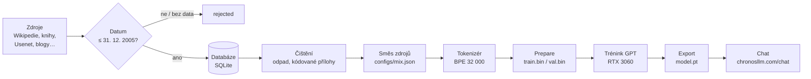

<div align="center">

# ChronosLLM · LLM 2005

**Jazykový model, který zná svět jen do 31. 12. 2005.**

Vlastní GPT natrénovaný úplně od nuly – žádné předtrénované váhy, žádný text z doby po roce 2005.<br>
Nezná iPhone, Bitcoin, covid ani ChatGPT.

[](https://github.com/krystofholecek/rocnikovka3f_2026/actions/workflows/ci.yml)


**[chronosllm.com](https://chronosllm.com)** · [Jak to funguje krok za krokem](https://chronosllm.com/postup/) · [Chat](https://chronosllm.com/chat/)

[Přehled](#přehled) · [Jak to funguje](#jak-to-funguje) · [Data](#data) · [Model a trénink](#model-a-trénink) · [Rychlý start](#rychlý-start) · [Chat](#chat) · [Web](#web-a-nasazení) · [Plán](#plán) · [Tým](#tým)

</div>

---

## Přehled

Co by řekl ChatGPT, kdyby vznikl v roce 2005? Tahle ročníková práce 3.F (2026) to zkouší doslova:
vlastní jazykový model trénujeme **úplně od nuly** a **jen na textech, které vznikly nejpozději 31. 12. 2005**.
Na konci si s ním může kdokoli popovídat na webu [chronosllm.com](https://chronosllm.com/chat/).

| | |
|---|---|
| **Architektura** | GPT (decoder-only Transformer, styl nanoGPT); hlavní model ~125 M parametrů (velikost GPT-2 small) |
| **Tokenizér** | vlastní byte-level BPE, 32 000 tokenů, natrénovaný jen na našich datech (~3,9 znaku na token) |
| **Data** | ≈ 3,6 mil. dokumentů, ≈ 20 mld. znaků: Wikipedie, knihy, Usenet, blogy, e-maily, soudní rozhodnutí a další |
| **Hardware** | jedna grafická karta NVIDIA RTX 3060 (12 GB), trénink přes noc |
| **Výstup** | web [chronosllm.com](https://chronosllm.com) s chatem; API v Djangu na vlastním serveru |

**Jediné pravidlo, na kterém stojí všechno:** datum u zdroje bereme jako pravdivé a **dokument bez data nebo
s datem po 31. 12. 2005 do trénovacích dat nikdy nepustíme**. Zamítnuté dokumenty se ukládají zvlášť
(tabulka `rejected` s důvodem), aby šlo vše zpětně ověřit.

## Jak to funguje



| Krok | Příkaz | Výstup |
|---|---|---|
| 1. Zdroj → kontrola data → databáze | `python -m llm2005.ingest wikipedia <soubor>` (další zdroje viz [docs/data-a-zdroje.md](docs/data-a-zdroje.md)) | `data/llm2005.sqlite` |
| 2. Přehled databáze | `python -m llm2005.ingest stats` | počty dokumentů a znaků podle zdroje |
| 3. Tokenizér (vyvážená směs) | `python -m llm2005.tokenizer` | `data/tokenizer.json` |
| 4. Převod na tokeny | `python -m llm2005.prepare` | `data/train.bin`, `data/val.bin` |
| 5. Trénink | `python -m llm2005.train --config configs/small.json --hours 8` | `checkpoints/small/ckpt.pt` |
| 6. Vyzkoušet model | `python -m llm2005.sample --config configs/small.json --prompt "The Internet is"` | vygenerovaný text |
| 7. Připravit pro chat | `python -m llm2005.export --config configs/base.json` | `checkpoints/chat/model.pt` + `tokenizer.json` |

Podrobně (pro techniky): [docs/architektura.md](docs/architektura.md). Jednoduše (pro všechny): [chronosllm.com/postup](https://chronosllm.com/postup/).

## Data

Stav k 7. 11. 2026. Všechny dokumenty prošly kontrolou data; 518 dokumentů s falešným „nulovým“ datem
(1. 1. 1970 apod.) jsme dodatečně přesunuli mezi zamítnuté.

| Zdroj | Dokumentů | Znaků | Období | Jak se datuje |
|---|---:|---:|---|---|
| Wikipedie – články (archiv 2006, historie revizí) | 838 895 | 1,95 mld. | 2003–2005 | poslední revize do 31. 12. 2005 |
| Wikipedie – diskuzní stránky | 165 254 | 0,26 mld. | 2002–2005 | poslední revize do 31. 12. 2005 |
| Knihy, Project Gutenberg (PG-19) | 28 750 | 11,48 mld. | 1483–1918 | rok vydání |
| Usenet (archiv UTZOO) | 1 516 330 | 2,19 mld. | převážně 1981–1991 | hlavička `Date:` |
| Blogy (Blog Authorship Corpus) | 511 984 | 0,72 mld. | 1999–2005 | datum příspěvku |
| E-maily (Enron) | 149 633 | 0,29 mld. | převážně 1999–2002 | hlavička `Date:` |
| Soudní rozhodnutí USA (CourtListener) | 381 171 | 3,55 mld. | 1980–2005 | datum rozhodnutí |
| Wikisource, Wikinews, Wikibooks, Wikiquote | 9 599 | 0,03 mld. | 2003–2005 | poslední revize |
| arXiv (abstrakty) | 6 092 | 0,005 mld. | 1991–2005 | datum poslední verze |
| **Celkem** | **≈ 3,6 mil.** | **≈ 20,5 mld.** | | |

Pro trénink se zdroje **míchají** (`configs/mix.json`): víc běžné řeči (diskuze, blogy, e-maily, Wikipedie),
méně knih z 19. století a soudních textů, aby model mluvil přirozeně. Z první směsi (~3 mld. znaků) vzniklo
**782 mil. tokenů** pro trénink a **3,7 mil.** pro kontrolu (val). Licence a citace všech zdrojů:
[docs/data-a-zdroje.md](docs/data-a-zdroje.md).

## Model a trénink

| Konfigurace | Parametrů | K čemu |
|---|---|---|
| `configs/tiny.json` | ~4 M | test, že vše funguje; poběží i bez GPU |
| `configs/small.json` | ~23 M | první model; na RTX 3060 ~75 tis. tokenů/s, ~7 h (odhad) |
| `configs/base.json` | ~125 M | hlavní model, cíl ~2,5 mld. tokenů, odhad ≈ 4 noci |

**Stav k 7. 11. 2026:** běží trénink `small` (krok ~6 350 z 28 000, val loss 3,83; na začátku ~10,4 = náhodné hádání).
Trénink se průběžně ukládá a po přerušení pokračuje, takže jde běžet po nocích.
Podrobnosti (parametry, paměť GPU, jak číst loss): [docs/trenink.md](docs/trenink.md).

## Rychlý start

```bash
git clone https://github.com/krystofholecek/rocnikovka3f_2026.git
cd rocnikovka3f_2026

python -m venv .venv
source .venv/bin/activate              # Windows: .venv\Scripts\activate
# PyTorch s NVIDIA GPU: https://pytorch.org/get-started/locally/ (verze s CUDA)
pip install -r requirements/dev.txt    # trénink + chat + testy (jen trénink: requirements/train.txt)

pytest                                 # testy (data, model, chat)
ruff check .                           # kontrola stylu
```

| Soubor | Co instaluje |
|---|---|
| `requirements/train.txt` | trénink a zpracování dat: torch, numpy, tokenizers |
| `requirements/chat.txt` | backend chatu: Django, gunicorn + totéž pro inferenci |
| `requirements/dev.txt` | vše výše + pytest a ruff |

## Chat

Backend chatu je malé API v Djangu ([chat/README.md](chat/README.md)): načte model, odpovídá po tokenech
(streamování), hlídá limity a nic neukládá. Když model ještě není, odpoví „Model se zrovna trénuje, zkus to později.“

```bash
python -m llm2005.export --config configs/small.json   # model + tokenizér do checkpoints/chat/
DJANGO_DEBUG=true python manage.py runserver            # API na http://127.0.0.1:8000
CHAT_API_URL=http://127.0.0.1:8000 python scripts/build_site.py && python -m http.server -d dist 8080
# web na http://127.0.0.1:8080/chat/
```

Na serveru běží v Dockeru (`docker compose --profile tunnel up -d`) za Cloudflare Tunnel na `api.chronosllm.com`.
Návod krok za krokem: [docs/nasazeni.md](docs/nasazeni.md).

## Web a nasazení

| Adresa | Zdroj v repu |
|---|---|
| [chronosllm.com](https://chronosllm.com) | `web/landing/` |
| [chronosllm.com/postup/](https://chronosllm.com/postup/) | `web/postup/` – jak model vzniká, jednoduše i podrobně |
| [chronosllm.com/chat/](https://chronosllm.com/chat/) | `web/chat/` – chat s modelem |
| [chronosllm.com/tokenizer/](https://chronosllm.com/tokenizer/) | `web/tokenizer-lab/` – samostatný doprovodný web (jen pro tým) |
| [chronosllm.com/version.json](https://chronosllm.com/version.json) | commit, větev a čas buildu nasazené verze |

Web se nasazuje **automaticky přes Cloudflare Workers Builds po každém mergi do `main`**:
build příkaz `python scripts/build_site.py` složí stránky do `dist/` (adresu API chatu vezme z `CHAT_API_URL`)
a deploy příkaz `npx wrangler deploy` je podle `wrangler.jsonc` nahraje jako statické soubory.
Podrobně: [docs/nasazeni.md](docs/nasazeni.md).

## Struktura repozitáře

```text
llm2005/          data a model (Python)
├── sources/      čtení zdrojů (Wikipedie, PG-19, Enron, blogy, arXiv, Usenet, Wikimedia, CourtListener, JSONL)
├── ingest.py, download.py, modern_data.py   stažení zdrojů a import do databáze
├── datecheck.py  kontrola data (hranice 31. 12. 2005)
├── db.py         databáze dokumentů (SQLite)
├── tokenizer.py, prepare.py   tokenizér a převod na tokeny
├── model.py, train.py, sample.py, benchmark.py   GPT, trénink, generování, měření rychlosti
├── export.py     příprava natrénovaného modelu pro chat
└── tests/        testy
chat/             backend chatu (Django API, Docker) – viz chat/README.md
web/              statický web: landing/, postup/, chat/, tokenizer-lab/
scripts/          build_site.py – složení webu do dist/
configs/          velikosti modelu a směs zdrojů
docs/             dokumentace (architektura, data, trénink, nasazení, bezpečnost)
requirements/     závislosti: train.txt, chat.txt, dev.txt
data/, checkpoints/   data a natrénované modely (nejsou v gitu, jsou velké)
```

## Dokumentace

| Dokument | Obsah |
|---|---|
| [docs/architektura.md](docs/architektura.md) | jak do sebe části zapadají, formáty souborů, model |
| [docs/data-a-zdroje.md](docs/data-a-zdroje.md) | zdroje, jak se datují, licence a citace |
| [docs/trenink.md](docs/trenink.md) | trénink krok za krokem, parametry, co dělat, když něco nejde |
| [docs/nasazeni.md](docs/nasazeni.md) | web (Cloudflare) a chat (Docker + Cloudflare Tunnel), co udělat, až bude model hotový |
| [docs/bezpecnost.md](docs/bezpecnost.md) | tajné údaje, ochrana API, soukromí |
| [chat/README.md](chat/README.md) | API chatu a jeho nastavení |
| [web/tokenizer-lab/README.md](web/tokenizer-lab/README.md) | Tokenizer Lab |

## Plán

| Milník | Cíl | Termín |
|---|---|---|
| 1. Data | všechny zdroje a ≥ 1 mld. tokenů | 30. 11. 2026 ✅ hotovo 6. 11. |
| 2. Malý model | první natrénovaný model `small`, ověření postupu; web s chatem připravený | 20. 12. 2026 |
| 3. Velký model | hlavní trénink `base`, chat spuštěný na chronosllm.com | 31. 1. 2027 |
| 4. Vyhodnocení a práce | testování, psaní textu, obhajoba | 28. 2. 2027 |

Podrobný přehled a úkoly jsou v [issue #6](https://github.com/krystofholecek/rocnikovka3f_2026/issues/6).

## Tým

Kryštof Holeček · Jáchym Milý · Marek Gregor

Ročníková práce, gymnázium, 3.F, školní rok 2026/2027.

## Jak přispívat

Pracujeme přes větve a pull requesty, do `main` se přímo nepushuje a každý PR potřebuje jedno schválení od jiného člena.
Před PR: `pytest` a `ruff check .`. Postup je v [CONTRIBUTING.md](CONTRIBUTING.md).

## Použití AI v projektu

Na vývoji se podílí AI asistent **Claude (Anthropic)**: pomáhá psát a upravovat kód, dokumentaci a automatizace týmu. Veškerý výstup kontrolujeme a každý člen týmu musí umět svůj podíl vysvětlit a obhájit.

Samotný jazykový model je od AI nezávislý: trénujeme ho od nuly, bez převzatých vah (GPT, Llama a podobných) a výhradně na textech z doby do konce roku 2005.

<div align="center"><sub>ChronosLLM · LLM 2005 · ročníková práce 3.F · 2026</sub></div>
