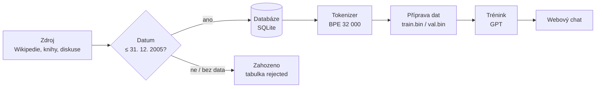

<div align="center">

# LLM 2005

**Jazykový model, který zná svět jen do 31. 12. 2005.**

Vlastní GPT natrénovaný od nuly. Žádné předtrénované váhy, žádná data z doby po roce 2005.<br>
Nezná iPhone, Bitcoin, covid ani ChatGPT.

[](https://github.com/krystofholecek/rocnikovka3f_2026/actions/workflows/ci.yml)


[Přehled](#přehled) · [Jak to funguje](#jak-to-funguje) · [Data](#data) · [Model](#model) · [Rychlý start](#rychlý-start) · [Plán](#plán) · [Tým](#tým)

</div>

---

## Přehled

Co by řekl ChatGPT, kdyby vznikl v roce 2005? Tohle je ročníková práce 3.F (2026), která to zkouší doslova: vlastní jazykový model trénujeme **úplně od nuly** a **jen na textech, které vznikly nejpozději 31. 12. 2005**. Na konci bude webový chat, kde si s modelem může popovídat kdokoli.

| | |
|---|---|
| **Architektura** | GPT (decoder-only Transformer), velikost GPT-2 small (~125 M parametrů) |
| **Tokenizer** | vlastní byte-level BPE, 32 000 tokenů |
| **Trénovací data** | Wikipedie, knihy (Project Gutenberg), diskuse (Usenet), vše s ověřeným datem ≤ 31. 12. 2005 |
| **Hardware** | jedna grafická karta NVIDIA RTX 3060, trénink přes noc |
| **Výstup** | webový chat (Django) |

## Jak to funguje

Důležité je pravidlo: **datum u zdroje bereme jako pravdivé, dokument bez data nepoužijeme.** Cokoli novějšího než 31. 12. 2005 se do trénovacích dat nikdy nedostane.



| Krok | Příkaz | Výstup |
|---|---|---|
| 1. Zdroj → kontrola data → databáze | `python -m llm2005.ingest wikipedia <soubor>` | `data/llm2005.sqlite` |
| 2. Přehled databáze | `python -m llm2005.ingest stats` | počty dokumentů a znaků podle zdroje |
| 3. Vlastní tokenizer | `python -m llm2005.tokenizer` | `data/tokenizer.json` |
| 4. Převod na tokeny | `python -m llm2005.prepare` | `data/train.bin`, `data/val.bin` |
| 5. Trénink | `python -m llm2005.train --config configs/small.json --hours 8` | `checkpoints/small/` |
| 6. Vyzkoušet model | `python -m llm2005.sample --config configs/small.json --prompt "The Internet is"` | vygenerovaný text |

Trénink se průběžně ukládá. Když ho spustíš znovu, pokračuje tam, kde skončil, takže jde běžet po nocích.

## Data

| Zdroj | Stav | Jak se datuje |
|---|---|---|
| Wikipedie (historie revizí, archiv z roku 2006) | **hotovo**: 838 895 článků, ≈ 0,46 mld. tokenů | poslední revize článku do 31. 12. 2005 |
| Knihy, Project Gutenberg (PG-19) | plán | datum vydání |
| Usenet | plán | datum příspěvku |

Cíl milníku Data: **≥ 1 mld. tokenů**. Jiný zdroj stačí převést na JSON Lines (`source`, `source_id`, `date`, `text`) a nahrát přes `python -m llm2005.ingest jsonl soubor.jsonl`.

## Model

| Konfigurace | Parametrů | K čemu |
|---|---|---|
| `tiny.json` | ~4 M | test, že vše funguje; poběží i na notebooku bez GPU |
| `small.json` | ~25 M | pokusy, na GPU hodiny |
| `base.json` | ~125 M | hlavní model, ~2,5 mld. tokenů, odhad ≈ 4 noci na RTX 3060 |

Rychlost jsme změřili: ~22 000 tokenů za sekundu při ~7 GB paměti grafiky. Odhad doby hlavního tréninku z toho vychází, finální číslo ukáže až samotný běh.

## Rychlý start

```bash
git clone https://github.com/krystofholecek/rocnikovka3f_2026.git
cd rocnikovka3f_2026

python -m venv .venv
source .venv/bin/activate          # Windows: .venv\Scripts\activate
# PyTorch s NVIDIA GPU: https://pytorch.org/get-started/locally/  (verze s CUDA)
pip install -r requirements-llm.txt

pytest llm2005                     # testy
```

## Struktura repozitáře

```text
llm2005/          model a celý řetězec zpracování dat
├── sources/      čtení zdrojů (Wikipedie, JSONL); nový zdroj = nový soubor
├── datecheck.py  kontrola data (hranice 31. 12. 2005)
├── db.py         databáze dokumentů (SQLite)
├── tokenizer.py, prepare.py   tokenizer a převod na tokeny
├── model.py, train.py, sample.py, benchmark.py   GPT, trénink, generování, měření rychlosti
└── tests/        testy
configs/          velikosti modelu a nastavení tréninku
config/ core/ templates/ static/   kostra webového chatu (Django)
data/, checkpoints/                data a natrénované modely (nejsou v gitu, jsou velké)
```

## Plán

| Milník | Cíl | Termín |
|---|---|---|
| 1. Data | všechny zdroje a ≥ 1 mld. tokenů | 30. 11. 2026 |
| 2. Malý model | první natrénovaný model, ověření postupu | 20. 12. 2026 |
| 3. Velký model | hlavní trénink (`base`), webový chat | 31. 1. 2027 |
| 4. Vyhodnocení a práce | testování, psaní textu, obhajoba | 28. 2. 2027 |

Podrobný přehled a úkoly jsou v [issue #6](https://github.com/krystofholecek/rocnikovka3f_2026/issues/6).

## Tým

Kryštof Holeček · Jáchym Milý · Marek Gregor

Ročníková práce, gymnázium, 3.F, školní rok 2026/2027.

## Jak přispívat

Pracujeme přes větve a pull requesty, do `main` se přímo nepushuje a každý PR potřebuje jedno schválení od jiného člena. Postup je v [CONTRIBUTING.md](CONTRIBUTING.md).

## Použití AI v projektu

Na vývoji se podílí AI asistent **Claude (Anthropic)**: pomáhá psát a upravovat kód, dokumentaci a automatizace týmu. Veškerý výstup kontrolujeme a každý člen týmu musí umět svůj podíl vysvětlit a obhájit.

Samotný jazykový model je od AI nezávislý: trénujeme ho od nuly, bez převzatých vah (GPT, Llama a podobných) a výhradně na textech z doby do konce roku 2005.

<div align="center"><sub>LLM 2005 · ročníková práce 3.F · 2026</sub></div>
