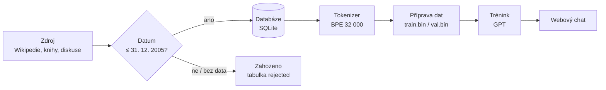

<div align="center">

# LLM 2005

**Jazykový model, který zná svět jen do 31. 12. 2005.**

Vlastní GPT natrénovaný od nuly. Žádné předtrénované váhy, žádná data z doby po roce 2005.<br>
Nezná iPhone, Bitcoin, covid ani ChatGPT.

[](https://github.com/krystofholecek/rocnikovka3f_2026/actions/workflows/ci.yml)


[Přehled](#přehled) · [Jak to funguje](#jak-to-funguje) · [Data](#data) · [Model](#model) · [Rychlý start](#rychlý-start) · [Plán](#plán) · [Tým](#tým)

</div>

---

## Přehled

Co by řekl ChatGPT, kdyby vznikl v roce 2005? Tohle je ročníková práce 3.F (2026), která to zkouší doslova: vlastní jazykový model trénujeme **úplně od nuly** a **jen na textech, které vznikly nejpozději 31. 12. 2005**. Na konci bude webový chat, kde si s modelem může popovídat kdokoli.

| | |
|---|---|
| **Architektura** | GPT (decoder-only Transformer), velikost GPT-2 small (~125 M parametrů) |
| **Tokenizer** | vlastní byte-level BPE, 32 000 tokenů |
| **Trénovací data** | ~20 mld. znaků (≈ 5 mld. tokenů, odhad): Wikipedie, knihy, Usenet, blogy, e-maily, soudní rozhodnutí a další; vše s ověřeným datem ≤ 31. 12. 2005 |
| **Hardware** | jedna grafická karta NVIDIA RTX 3060, trénink přes noc |
| **Výstup** | webový chat (Django) na [chronosllm.com](https://chronosllm.com) (zatím ve vývoji) |

## Jak to funguje

Důležité je pravidlo: **datum u zdroje bereme jako pravdivé, dokument bez data nepoužijeme.** Cokoli novějšího než 31. 12. 2005 se do trénovacích dat nikdy nedostane.



| Krok | Příkaz | Výstup |
|---|---|---|
| 1. Zdroj → kontrola data → databáze | `python -m llm2005.ingest wikipedia <soubor>` | `data/llm2005.sqlite` |
| 2. Přehled databáze | `python -m llm2005.ingest stats` | počty dokumentů a znaků podle zdroje |
| 3. Vlastní tokenizer (vyvážená směs, živý přehled) | `python -m llm2005.tokenizer` | `data/tokenizer.json`, report v `data/progress/` |
| 4. Převod na tokeny | `python -m llm2005.prepare` | `data/train.bin`, `data/val.bin` |
| 5. Trénink | `python -m llm2005.train --config configs/small.json --hours 8` | `checkpoints/small/` |
| 6. Vyzkoušet model | `python -m llm2005.sample --config configs/small.json --prompt "The Internet is"` | vygenerovaný text |

Trénink se průběžně ukládá. Když ho spustíš znovu, pokračuje tam, kde skončil, takže jde běžet po nocích.
Běží s nižší prioritou a se stropem paměti grafiky, aby počítač zůstal použitelný. Proč: [docs/trenink-rychlost.md](docs/trenink-rychlost.md)
(model `small` ~85 000 tokenů/s na RTX 3060, před opravou ~2 000 kvůli přetečení paměti GPU).

## Data

Stav k 6. 11. 2026. Všechny dokumenty prošly kontrolou data; co je novější nebo bez data, skončilo v tabulce `rejected`.

| Zdroj | Dokumentů | Znaků | Období | Jak se datuje |
|---|---:|---:|---|---|
| Wikipedie – články (archiv 2006, historie revizí) | 838 895 | 1,95 mld. | 2003–2005 | poslední revize do 31. 12. 2005 |
| Wikipedie – diskuzní stránky | 165 254 | 0,26 mld. | 2002–2005 | poslední revize do 31. 12. 2005 |
| Knihy, Project Gutenberg (PG-19) | 28 750 | 11,48 mld. | 1483–1918 | rok vydání |
| Usenet (archiv UTZOO) | 1 516 330 | 2,19 mld. | převážně 1981–1991 | hlavička `Date:` |
| Blogy (Blog Authorship Corpus) | 511 984 | 0,72 mld. | 1999–2005 | datum příspěvku |
| E-maily (Enron) | 149 633 | 0,29 mld. | převážně 1999–2002 | hlavička `Date:` |
| Soudní rozhodnutí USA (CourtListener) | 381 171 | 3,55 mld. | 1980–2005 | datum rozhodnutí |
| Wikisource, Wikinews, Wikibooks, Wikiquote | 9 599 | 0,03 mld. | 2003–2005 | poslední revize |
| arXiv (abstrakty) | 6 092 | 0,005 mld. | 1991–2005 | datum poslední verze |
| **Celkem** | **≈ 3,6 mil.** | **≈ 20,5 mld.** | | ≈ 5 mld. tokenů (odhad) |

Cíl milníku Data (**≥ 1 mld. tokenů**) je splněný. Pro trénink se zdroje budou míchat v poměrech podle `configs/mix.json` (rozpracováno v [PR #20](https://github.com/krystofholecek/rocnikovka3f_2026/pull/20)): knih a soudních textů je méně, aby model mluvil přirozeně jako text z let kolem 2005.

Jiný zdroj stačí převést na JSON Lines (`source`, `source_id`, `date`, `text`) a nahrát přes `python -m llm2005.ingest jsonl soubor.jsonl`.

## Vyvážení dat (směs pro tokenizér)

Chceme, aby model „mluvil“ přirozeně jako text z let ~1995–2005: e-maily, blogy, diskuze, encyklopedie.
V databázi ale převažují knihy z 19. století (PG-19, ~11,5 mld. znaků) a soudní rozhodnutí (CourtListener).
Kdybychom vzali všechno, tokenizér by si slovník „utratil“ za staré a právnické obraty.
Proto bereme z každého zdroje jen podíl **podle počtu znaků** ([`configs/mix.json`](configs/mix.json), kód [`llm2005/mix.py`](llm2005/mix.py)):

| Zdroj | Podíl | Proč |
|---|---|---|
| usenet | 25 % | hovorová angličtina, diskuze 80.–90. let |
| wikipedia | 25 % | spisovný, věcný jazyk, široký záběr témat |
| blogs | 15 % | osobní psaní 1999–2005, slang, internetová kultura |
| pg19 (knihy) | 10 % | bohatá slovní zásoba, ale starý styl → jen menšina |
| wikipedia-talk | 8 % | diskuze o článcích 2002–2005 |
| enron | 7 % | firemní e-maily 1999–2002 |
| courtlistener | 7 % | právnický jazyk – užitečný, ale nechceme, aby převládl |
| arxiv, wikinews, wikibooks, wikiquote, wikisource | celé | malé zdroje (dohromady ~35 mil. znaků, ~1 %) |

Pravidla: malé zdroje celé, zbytek rozpočtu (max. **3 mld. znaků**) podle vah. Dokumenty každého zdroje se
zamíchají pevným seedem **2005** a berou se **celé** dokumenty, dokud zdroj nemá svůj podíl – výsledek je pokaždé stejný.
Když zdroj nemá dost textu, vezme se celý a chybějící část se poměrně rozdělí mezi ostatní (podle dat z listopadu 2026
mají všechny vážené zdroje textu dost). Plán bez čtení textů: `python -m llm2005.mix`.

### Trénink tokenizéru a živý přehled

```bash
python -m llm2005.progress_server      # přehled na http://localhost:8800 (jen tento počítač, jen čtení)
python -m llm2005.tokenizer            # vzorek -> trénink -> uložení -> kontrola
```

- Vzorek se uloží do `data/tokenizer-sample/` (JSONL podle zdroje); další běh se stejným nastavením ho použije znovu
  (`--resample` vynutí nový).
- Každé ~2 s se zapisuje `data/progress/tokenizer-status.json` (fáze, procenta, rychlost, ETA, zdroje, log)
  a stránka [`tools/progress/index.html`](tools/progress/index.html) ho zobrazuje (světlý/tmavý režim, i na tabletu).
- Při „skládání tokenů“ (BPE merges) knihovna `tokenizers` průběh nehlásí – procenta a ETA té fáze jsou **odhad**.
- Po tréninku vznikne `data/progress/tokenizer-report.json` (`python -m llm2005.tokenizer_report` ho vytvoří znovu):
  velikost slovníku, 30 nejdelších tokenů, rozdělení 5 ukázkových vět z roku 2005, znaků na token celkem i podle zdroje,
  podíl bajtových tokenů.
- Server lze pustit i dvojklikem na `tools/progress/start-server.bat`.

Zkušební běh na 150 mil. znaků (32 000 tokenů) trval ~1 min a dal ~4,0 znaku na token. Nejdelší tokeny byly
dlouhé řady mezer, pomlček a `=` (formátování e-mailů a Usenetu) – zabírají jen pár desítek míst ve slovníku,
ale je to kandidát na pozdější úklid dat.

### Čištění dat (za běhu, databáze se nemění)

První tokenizér na celé směsi (3 mld. znaků) měl 214 tokenů jen z mezer (až 512 mezer) a 289 tokenů z opakovaného
znaku (`-----`, `====`, `AAAA…` = binární přílohy). Proto text při výběru směsi (tokenizér i `prepare`) projde
`llm2005/clean.py`:

- binární přílohy (uuencode, base64/MIME, BinHex) se **odstraní úplně, bez značky** – značka typu
  „[příloha odstraněna]“ v textech z roku 2005 nikdy nebyla a model by ji jen napodoboval,
- odsazení max 16 znaků, uvnitř řádku max 4 mezery/tabulátory, mezery na konci řádku pryč,
- stejný znak max 8× za sebou (písmeno/číslice 16×), max 2 prázdné řádky, řídicí znaky pryč,
- dokument kratší než 200 znaků po vyčištění se do směsi nebere.

Analýza na vzorku: `python -m llm2005.clean_report` -> `data/progress/cleaning-report.json` (vidět v přehledu).
Nejvíc šumu má Enron (~9 % znaků, hlavně base64 přílohy) a Usenet (~3 %); Wikipedie, blogy a knihy pod 0,6 %.

Podezřelá data: 518 dokumentů mělo v hlavičce „nulové“ datum – Usenet `Wed, 31-Dec-69 18:59:59 EDT`
(unixový čas −1) a pár let 1970 (před vznikem Usenetu), Enron `Mon, 31 Dec 1979 16:00:00 -0800` (nula Outlooku).
Parsery je teď berou jako `no_date`; staré záznamy přesunul `python -m llm2005.fix_dates --apply` do `rejected`
s důvodem `suspicious_date`.

Celý řetězec po čištění (tokenizér -> porovnání s `data/tokenizer-v1.json` -> `prepare` -> krátký test `tiny`):
`python -m llm2005.rebuild_data`.

## Model

| Konfigurace | Parametrů | K čemu |
|---|---|---|
| `tiny.json` | ~4 M | test, že vše funguje; poběží i na notebooku bez GPU |
| `small.json` | ~25 M | pokusy, na GPU hodiny |
| `base.json` | ~125 M | hlavní model, ~2,5 mld. tokenů, odhad ≈ 4 noci na RTX 3060 |

Rychlost jsme změřili: ~22 000 tokenů za sekundu při ~7 GB paměti grafiky. Odhad doby hlavního tréninku z toho vychází, finální číslo ukáže až samotný běh.

## Rychlý start

```bash
git clone https://github.com/krystofholecek/rocnikovka3f_2026.git
cd rocnikovka3f_2026

python -m venv .venv
source .venv/bin/activate          # Windows: .venv\Scripts\activate
# PyTorch s NVIDIA GPU: https://pytorch.org/get-started/locally/  (verze s CUDA)
pip install -r requirements-llm.txt

pytest llm2005                     # testy
```

## Struktura repozitáře

```text
llm2005/          model a celý řetězec zpracování dat
├── sources/      čtení zdrojů (Wikipedie, PG-19, Enron, blogy, arXiv, Usenet, Wikimedia, CourtListener, JSONL);
│                 nový zdroj = nový soubor
├── ingest.py, download.py, modern_data.py   stažení zdrojů a import do databáze
├── datecheck.py  kontrola data (hranice 31. 12. 2005)
├── db.py         databáze dokumentů (SQLite)
├── mix.py        vyvážená směs zdrojů (configs/mix.json)
├── tokenizer.py, tokenizer_report.py, prepare.py   tokenizer, jeho kontrola a převod na tokeny
├── progress.py, progress_server.py   živý přehled průběhu (http://localhost:8800)
├── model.py, train.py, sample.py, benchmark.py   GPT, trénink, generování, měření rychlosti
└── tests/        testy
configs/          velikosti modelu a nastavení tréninku
config/ core/ templates/ static/   kostra webového chatu (Django)
data/, checkpoints/                data a natrénované modely (nejsou v gitu, jsou velké)
tools/progress/                    stránka živého přehledu (jeden HTML soubor)
web/landing/, web/postup/          úvodní stránka a postup krok za krokem (chronosllm.com)
web/tokenizer-lab/                 samostatný doprovodný web (viz níže)
scripts/build_site.py, wrangler.jsonc   složení a nasazení webu (viz níže)
```

### Doprovodný web: Tokenizer Lab

Složka [`web/tokenizer-lab/`](web/tokenizer-lab/README.md) je **samostatný projekt** – statický web v JavaScriptu,
který v prohlížeči ukazuje, jak náš BPE tokenizér skládá tokeny (trénink krok za krokem, barevné tokeny, pipeline
`prepare`). S hlavním projektem nesdílí kód, má vlastní README a testy a hlavní projekt na něm nezávisí. Běží na
[chronosllm.com/tokenizer](https://chronosllm.com/tokenizer/) (přístup jen pro tým).

### Nasazení webu

Web [chronosllm.com](https://chronosllm.com) se nasazuje automaticky přes Cloudflare Workers Builds po každém mergi do `main`.
Build příkaz `python scripts/build_site.py` složí úvodní stránku, postup a Tokenizer Lab do složky `dist/`.
Deploy příkaz `npx wrangler deploy` pak podle `wrangler.jsonc` nahraje obsah `dist/` jako statické soubory.

## Plán

| Milník | Cíl | Termín |
|---|---|---|
| 1. Data | všechny zdroje a ≥ 1 mld. tokenů | 30. 11. 2026 ✅ hotovo 6. 11. |
| 2. Malý model | první natrénovaný model, ověření postupu (tokenizér se trénuje) | 20. 12. 2026 |
| 3. Velký model | hlavní trénink (`base`), webový chat | 31. 1. 2027 |
| 4. Vyhodnocení a práce | testování, psaní textu, obhajoba | 28. 2. 2027 |

Podrobný přehled a úkoly jsou v [issue #6](https://github.com/krystofholecek/rocnikovka3f_2026/issues/6).

## Tým

Kryštof Holeček · Jáchym Milý · Marek Gregor

Ročníková práce, gymnázium, 3.F, školní rok 2026/2027.

## Jak přispívat

Pracujeme přes větve a pull requesty, do `main` se přímo nepushuje a každý PR potřebuje jedno schválení od jiného člena. Postup je v [CONTRIBUTING.md](CONTRIBUTING.md).

## Použití AI v projektu

Na vývoji se podílí AI asistent **Claude (Anthropic)**: pomáhá psát a upravovat kód, dokumentaci a automatizace týmu. Veškerý výstup kontrolujeme a každý člen týmu musí umět svůj podíl vysvětlit a obhájit.

Samotný jazykový model je od AI nezávislý: trénujeme ho od nuly, bez převzatých vah (GPT, Llama a podobných) a výhradně na textech z doby do konce roku 2005.

<div align="center"><sub>LLM 2005 · ročníková práce 3.F · 2026</sub></div>
