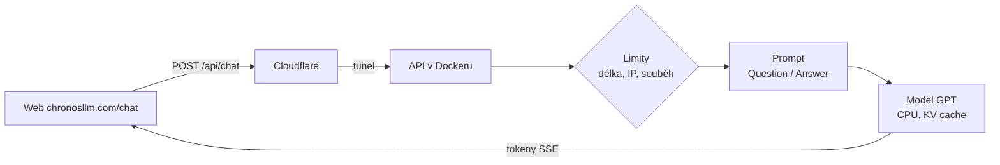

# Backend chatu (chat/)

Malé HTTP API nad natrénovaným modelem. Webová stránka chronosllm.com/chat/ posílá otázky sem
a odpověď dostává po kouscích (streamování), jak ji model píše.

Postavené na Djangu, ale jen jako API: žádná databáze, žádné účty, žádná administrace.
Konverzace se nikam neukládají, server si pamatuje jen anonymní počty (kolik dotazů, kolik tokenů).

## Jak to funguje



| Soubor | Co dělá |
|---|---|
| `engine.py` | načte checkpoint a tokenizér, generuje po tokenech (temperature, top_k, top_p, stop na `<\|endoftext\|>`) |
| `prompt.py` | převede konverzaci na text „Question: … Answer:“, který model umí doplnit |
| `views.py` | API: `/api/health`, `/api/info`, `/api/chat` |
| `limits.py` | limit dotazů podle IP, počet souběžných odpovědí, anonymní počty |
| `middleware.py` | CORS: API smí volat jen web chronosllm.com |
| `settings.py` | nastavení přes proměnné prostředí (bezpečné výchozí hodnoty) |

Model se učil hlavně z anglických textů, proto nejlépe odpovídá na anglické otázky.

## API

| Metoda | Adresa | Odpověď |
|---|---|---|
| GET | `/api/health` | `{"status": "ready" \| "no_model" \| "error", "ready": bool, "model": {...}, "version": {"commit"}, "stats": {...}}` |
| GET | `/api/info` | datum cutoff (`2005-12-31`), parametry modelu, výchozí nastavení a limity |
| POST | `/api/chat` | stream událostí (`text/event-stream`) nebo JSON |

Požadavek na `/api/chat`:

```json
{
  "messages": [{"role": "user", "content": "What is the Internet?"}],
  "stream": true,
  "max_new_tokens": 150, "temperature": 0.8, "top_k": 50, "top_p": 0.95
}
```

Stream posílá řádky `data: {...}`:
`{"type": "start"}`, pak `{"type": "token", "text": "..."}` a nakonec
`{"type": "done", "finish_reason": "stop" | "length" | "timeout", "tokens": 42, "seconds": 3.1}`.
S `"stream": false` přijde jeden JSON `{"reply": "...", "finish_reason": "...", "tokens": 42}`.

Chyby jsou JSON `{"error": "...", "message": "česká zpráva"}`:

| Kód | Kdy |
|---|---|
| 400 | špatný vstup (prázdná nebo moc dlouhá zpráva, špatné parametry) |
| 403 | požadavek z jiné stránky než chronosllm.com |
| 429 | moc dotazů z jedné IP (hlavička `Retry-After`) |
| 503 `model_unavailable` | model zatím není nahraný: „Model se zrovna trénuje, zkus to později.“ |
| 503 `busy` | všechna místa pro generování jsou obsazená |

## Spuštění lokálně (vývoj)

```bash
pip install -r requirements/dev.txt
python -m llm2005.export --config configs/small.json   # -> checkpoints/chat/model.pt + tokenizer.json
DJANGO_DEBUG=true python manage.py runserver            # PowerShell: $env:DJANGO_DEBUG="true"; python manage.py runserver
curl http://127.0.0.1:8000/api/health
curl -N -X POST http://127.0.0.1:8000/api/chat -H "Content-Type: application/json" \
     -d '{"message": "What is the Internet?"}'
```

Bez modelu API běží taky, jen `/api/chat` vrací 503 „Model se zrovna trénuje“.
Když se `model.pt` objeví později, server si ho do 30 sekund sám načte.

## Nastavení (proměnné prostředí)

| Proměnná | Výchozí | Význam |
|---|---|---|
| `DJANGO_SECRET_KEY` | – (povinné) | náhodný tajný klíč |
| `DJANGO_DEBUG` | `false` | jen pro vývoj |
| `DJANGO_ALLOWED_HOSTS` | `localhost,127.0.0.1` | na serveru `api.chronosllm.com` |
| `CHAT_MODEL_DIR` | `checkpoints/chat` | složka s `model.pt` a `tokenizer.json` |
| `CHAT_CHECKPOINT`, `CHAT_TOKENIZER` | v `CHAT_MODEL_DIR` | lze zadat i přímo `checkpoints/base/ckpt.pt` a `data/tokenizer.json` |
| `CHAT_DEVICE` | `auto` | `cpu`, `cuda` nebo `auto` |
| `CHAT_ALLOWED_ORIGINS` | `https://chronosllm.com,https://www.chronosllm.com` | odkud smí prohlížeč volat API |
| `CHAT_CLIENT_IP_HEADER` | – | za Cloudflare `CF-Connecting-IP` (jen když server není dostupný jinak) |
| `CHAT_MAX_INPUT_CHARS` | 1000 | max. délka otázky |
| `CHAT_MAX_NEW_TOKENS` | 256 | max. délka odpovědi v tokenech |
| `CHAT_TIMEOUT_SECONDS` | 45 | po této době se generování ukončí |
| `CHAT_RATE_LIMIT_PER_MINUTE` / `_PER_DAY` | 10 / 200 | dotazů z jedné IP |
| `CHAT_MAX_CONCURRENT` | 2 | kolik odpovědí se generuje najednou |

## Nasazení

Obě varianty používají Docker a **Cloudflare Tunnel**: server nemá otevřený žádný port, Cloudflare
k němu chodí odchozím spojením. Web (chronosllm.com) zůstává na Cloudflare Workers, API běží na
**api.chronosllm.com**.

### A) Malý VPS bez GPU

Stačí 2 jádra a 2–4 GB RAM (model `base` ~125 M parametrů potřebuje ~0,5 GB paměti).

1. Nainstaluj Docker a stáhni repo (`git clone`).
2. `cp .env.example .env`, vyplň `DJANGO_SECRET_KEY` a `CLOUDFLARE_TUNNEL_TOKEN`
   a nastav `DJANGO_ALLOWED_HOSTS=api.chronosllm.com,localhost,127.0.0.1`.
3. Nahraj model: `checkpoints/chat/model.pt` a `checkpoints/chat/tokenizer.json`
   (např. `scp -r checkpoints/chat server:~/rocnikovka3f_2026/checkpoints/`).
4. `GIT_COMMIT=$(git rev-parse HEAD) docker compose --profile tunnel up -d --build`
5. Ověř: `curl http://127.0.0.1:8000/api/health` a pak `https://api.chronosllm.com/api/health`.

### B) Domácí PC (Windows) přes Cloudflare Tunnel

Stejné jako A, jen s Docker Desktop. Model běží na CPU, takže nezatěžuje grafickou kartu.
Když je PC vypnuté, web ukáže „Model se zrovna trénuje, zkus to později.“

### Nastavení tunelu v Cloudflare (jednou)

1. Cloudflare Zero Trust → Networks → Tunnels → **Create a tunnel** (typ cloudflared), pojmenuj např. `chronosllm-api`.
2. Zkopíruj token do `.env` jako `CLOUDFLARE_TUNNEL_TOKEN`.
3. Public hostname: `api.chronosllm.com` → Service `http://chat:8000` (služba z docker compose).
4. **Cloudflare Access nesmí chránit `api.chronosllm.com`** (prohlížeč by nedostal odpověď kvůli přihlašovací stránce).
   API chrání limity; pokud má být chat jen pro tým, nech Access na stránce `chronosllm.com/chat/`.
5. Web volá API na adrese z buildu (`CHAT_API_URL`, výchozí `https://api.chronosllm.com`).

## Bezpečnost

- Žádné spouštění kódu: checkpoint se načítá s `weights_only=True`, model jen generuje text.
- Vstup i výstup mají limity (znaky, tokeny, čas), dotazy z jedné IP jsou omezené, souběžné generování taky.
- CORS jen pro chronosllm.com, požadavky z jiných stránek se odmítnou.
- Nic se neukládá: žádná databáze, přístupový log vypnutý, IP adresy jen v paměti jako otisk s náhodnou solí.
- Kontejner běží jako neprivilegovaný uživatel, souborový systém jen pro čtení, model připojený jen pro čtení.
- Tajné údaje jen v `.env` (není v gitu).
