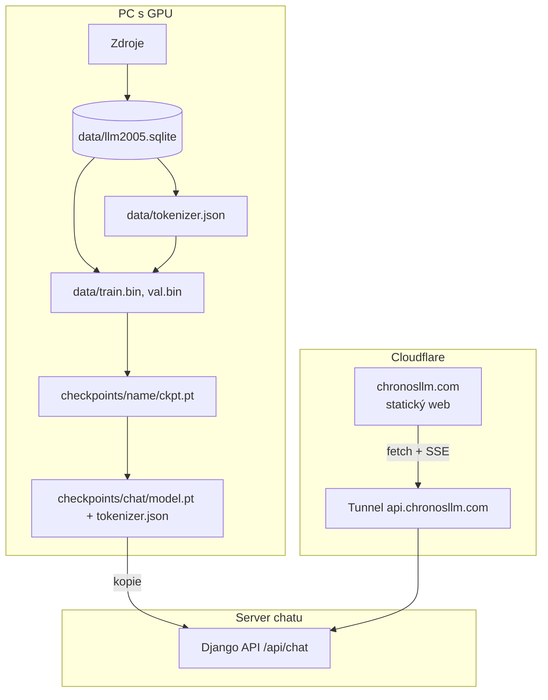

# Architektura

Projekt má tři samostatné části, které spojují jen soubory na disku a HTTP:

| Část | Složka | Jazyk | Kde běží |
|---|---|---|---|
| Data a model | `llm2005/` | Python (PyTorch) | PC s grafickou kartou (trénink) |
| Backend chatu | `chat/` | Python (Django) | VPS nebo domácí PC v Dockeru (CPU) |
| Web | `web/` + `scripts/build_site.py` | HTML, CSS, JS | Cloudflare Workers (statické soubory) |

## Řetězec dat (llm2005/)

1. **Zdroje** (`llm2005/sources/*.py`): každý zdroj má parser, který ze surového formátu (XML dump Wikipedie,
   archivy Usenetu, CSV, JSONL…) udělá jednotný dokument `Document(source, source_id, date, text)`.
2. **Kontrola data** (`datecheck.py`): dokument bez data nebo s datem po 31. 12. 2005 skončí v tabulce `rejected`
   s důvodem. Datum bereme ze zdroje (hlavička `Date:`, datum revize, rok vydání).
3. **Databáze** (`db.py`): SQLite `data/llm2005.sqlite`, tabulky `documents` a `rejected`.
4. **Čištění** za běhu (nepřepisuje databázi): odstraní kódované přílohy (uuencode, base64), dlouhé řady znaků
   a prázdných řádků; příliš krátké dokumenty přeskočí.
5. **Směs** (`configs/mix.json`): podíly zdrojů podle znaků, vzorkuje se po celých dokumentech se seedem 2005.
6. **Tokenizér** (`tokenizer.py`): byte-level BPE, 32 000 tokenů, speciální token `<|endoftext|>` mezi dokumenty.
   Natrénovaný jen na naší směsi – žádný cizí slovník.
7. **Prepare** (`prepare.py`): tokeny jako `uint16` do `data/train.bin` a `data/val.bin` (0,5 % dokumentů).

## Model (llm2005/model.py)

GPT ve stylu nanoGPT: vstupní a poziční embedding, `n_layer` bloků (LayerNorm → causal self-attention →
LayerNorm → MLP 4× s GELU), sdílené váhy vstupního embeddingu a výstupní vrstvy. Váhy začínají náhodně.

| | tiny (test) | small | base |
|---|---:|---:|---:|
| vrstev × hlav | 2 × 2 | 6 × 6 | 12 × 12 |
| šířka (`n_embd`) | 128 | 384 | 768 |
| kontext (tokenů) | 128 | 512 | 1024 |
| parametrů | ~4 M | ~23 M | ~125 M |

Přesné hodnoty jsou v `configs/*.json` (tiny má malou šířku, ale plný slovník 32 000 tokenů).

## Formáty souborů

| Soubor | Obsah |
|---|---|
| `checkpoints/<name>/ckpt.pt` | `{"model": state_dict, "optimizer": ..., "step": int, "best_val": float, "config": {...}}` – pro pokračování tréninku |
| `checkpoints/chat/model.pt` | `{"model": state_dict, "config": {"name", "model": {...}}, "step", "format": "llm2005-chat-1"}` – jen pro chat (z `python -m llm2005.export`) |
| `data/tokenizer.json` | tokenizér ve formátu knihovny Hugging Face `tokenizers` |
| `data/train.bin`, `val.bin` | tokeny `uint16` za sebou, dokumenty oddělené `<|endoftext|>` |
| `dist/version.json` | commit, větev, čas buildu a adresa API nasazeného webu |

## Chat (chat/)

API v Djangu bez databáze. `engine.py` načte `model.pt` (s `weights_only=True`) a generuje s KV cache
(každý nový token stojí jeden krok modelu, ne přepočet celého textu). Konverzace se převede na text
„Question: … Answer:“ (`prompt.py`), protože model není chatbot – umí jen pokračovat v textu.
Podrobnosti a API: [chat/README.md](../chat/README.md).

## Web (web/)

Čisté HTML/CSS/JS bez knihoven a bez buildovacích nástrojů. `scripts/build_site.py` stránky jen zkopíruje
do `dist/`, doplní adresu API chatu a zapíše `version.json`. Tokenizer Lab je samostatný projekt
(vlastní README a testy), na webu běží na `/tokenizer/`.
